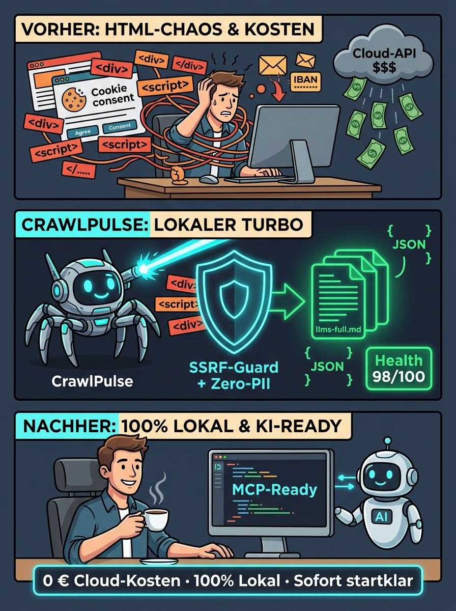
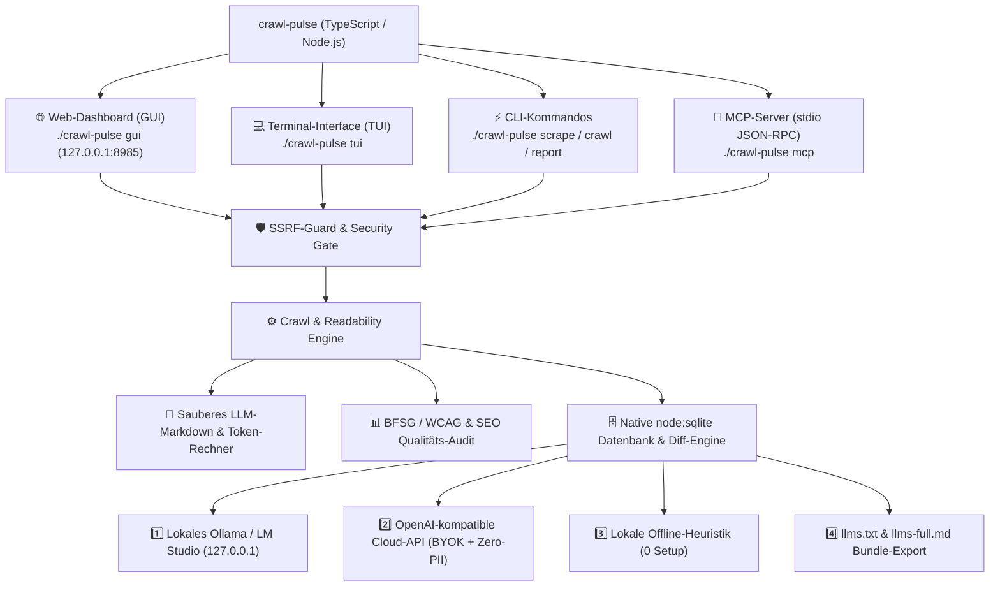
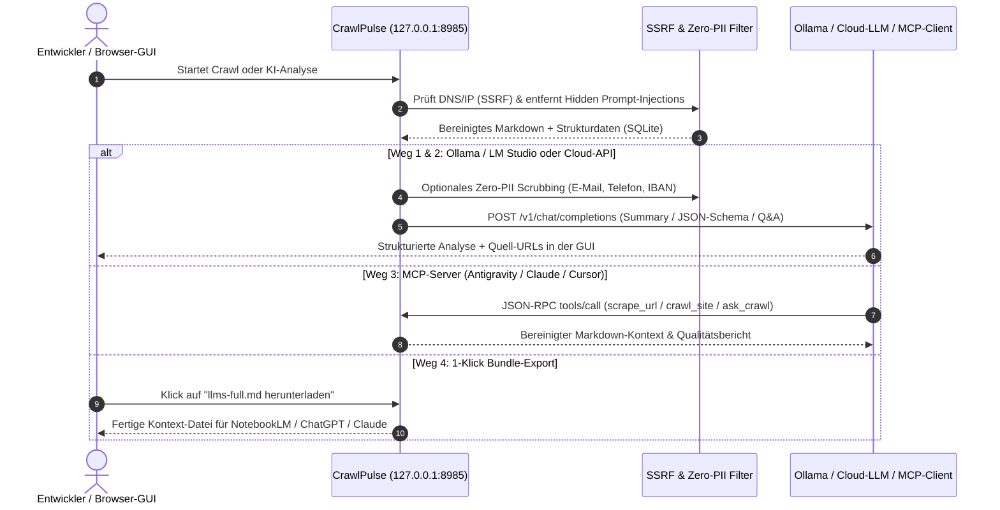

# 🕸️ CrawlPulse — Lokale Web-Crawl, Markdown & KI-Kontext-Engine

> Eine selbst-hostbare, sofort startbare **TypeScript / Node.js Web-Crawling-, Markdown- und KI-Analyse-Engine** analog zu WaterCrawl/Firecrawl — mit barrierefreier Web-GUI (Apple HIG Dark/Light Design, WCAG 2.2 AA / BFSG), Live-Monitor via Server-Sent Events (SSE), lokaler SQLite-Historie, 4-Wege-KI-Anbindung und integriertem MCP-Server.
>
> **Autor:** Aleksey Krivonos · **Lizenz:** [MIT](../LICENSE)
>
> **Herkunft:** Die erklärenden Texte und die Infografik sind KI-erzeugt.

<p align="center">
  
  <br>
  Herkunft der Abbildung: KI-erzeugt.
</p>

---

## 📍 Übersicht & Architektur

CrawlPulse verwandelt unstrukturierte Websites lokal auf dem eigenen Rechner in **bereinigtes LLM-Markdown**, extrahiert **Schema.org JSON-LD & OpenGraph-Metadaten**, prüft Seiten auf **technische SEO- und BFSG-Barrierefreiheits-Mängel** und stellt den gesamten Kontext über **4 KI-Wege** bereit.

- **Laufzeitdaten:** `~/.crawl-pulse/crawl-pulse.db` (Ausweichpfad `/tmp/crawl-pulse/crawl-pulse.db`)
- **Laufzeit-Voraussetzung:** Node.js v22.6+ / v26 (Zero-Dependency TypeScript: kein `npm install`, kein Docker, kein Redis, kein PostgreSQL erforderlich).
- **Sicherheitsarchitektur:** Strikter SSRF-Guard (IPv4/IPv6/DNS-Rebinding/Redirect-Prüfung), Protokoll-Whitelist (`http:`/`https:`), Prompt-Injection- & Hidden-DOM-Filter, Zero-PII-Schwärzung und strikte `127.0.0.1`-Bindung.



---

## 🎯 5 Praxis-Use-Cases: Auswertung, Optimierung & Kostenersparnis

Die ausführliche Dokumentation aller 5 Szenarien inklusive rechtlicher Einordnung und Kostenvergleich findest du in [docs/use-cases.md](./docs/use-cases.md):

1. **Eigene Website für KI-Suchmaschinen (GEO) und das BFSG auditieren:** Lokaler 0-€-Ersatz für teure Barrierefreiheits- und SEO-Suiten mit automatischer Erkennung fehlender Alt-Texte, Sprachattribute und Schema.org JSON-LD-Strukturdaten.
2. **Drastische Kosten- und Token-Ersparnis gegenüber Cloud-Crawlern & LLM-APIs:** 70–85 % weniger Token-Ballast durch automatisches Filtern von Mega-Menüs und Cookie-Bannern; 0 € variable API-Kosten in Kombination mit lokalem Ollama (`qwen2.5-coder:7b`).
3. **DSGVO-konforme KI-Auswertung des eigenen Webauftritts (Zero-PII & kein Cloud-Leak):** Deterministische Schwärzung von E-Mails, Telefonnummern und IBANs vor der Analyse; alle Daten bleiben in der lokalen SQLite-Datenbank geschützt.
4. **Automatische Erstellung des eigenen KI-Kontext-Bundles (`llms.txt` & `llms-full.md`):** Maschinengerechte Bereitstellung der eigenen Website- und Doku-Inhalte für AI-Coding-Agenten (Antigravity, Cursor, Claude Code) und MCP.
5. **Relaunch-Monitoring & Regressionsprüfung ohne externe Überwachungstools:** Integrierter `compareRuns`-Diff zur lückenlosen Erkennung von Content-Verlusten, URL-Ausfällen und Ranking-Risiken nach Redesigns.

---

## 🚀 Schnellstart & Bedienung

Im geklonten Projektverzeichnis:

```bash
chmod +x ./crawl-pulse
```

### 1. Web-Dashboard im Browser starten (GUI)
Startet den lokalen HTTP- und SSE-Server auf `127.0.0.1:8985`:

```bash
./crawl-pulse gui
# Optional mit eigenem Port:
./crawl-pulse gui --port 8990
```

- **Standard-Adresse:** `http://127.0.0.1:8985`
- **🚀 Cockpit:** Ziel-URL, Modus (*Einzelseite*, *Domain-Crawl*, *Sitemap-Scan*), Seiten-/Tiefenlimits, Pfad-Filter (`include`/`exclude`), CSS-Selektor und Sicherheits-Schalter konfigurieren.
- **📡 Live-Monitor (SSE):** Echtzeit-Fortschrittsbalken, Live-Event-Stream, Token-Zähler und sofortiger **Stopp-Button**.
- **🔍 Ergebnis-Inspektor (Split-View):** Sofort-Suche über alle gecrawlten Unterseiten mit 4 Detail-Ansichten (*LLM-Markdown mit 1-Klick-Kopieren*, *Metadaten & Schema.org JSON-LD*, *BFSG/SEO-Audit*, *Bereinigtes HTML*).
- **📊 Berichte & Export-Zentrale:** Health-Score (`0–100`), Antwortzeiten, Barrierefreiheits-Zähler und 1-Klick-Download als `llms-full.md`, `llms.txt`, `JSON` oder `CSV`.
- **🤖 KI-Studio & MCP:** Live-Erkennung lokaler Modelle (Ollama/LM Studio), API-Key-Konfiguration mit Zero-PII-Schutz sowie direkte Ausführung von *Executive Summary*, *JSON-Schema-Extraktion* und *Website-Q&A*.
- **🗄️ SQLite-Historie & Diff-Vergleich:** Dauerhafte Speicherung aller Läufe inkl. Änderungsvergleich (*Diff*) zwischen zwei Zeitpunkten.

---

### 2. Interaktives Terminal-Menü (TUI)
Für die schnelle Steuerung direkt im Terminalfenster:

```bash
./crawl-pulse tui
```

- `N`: Neuen Crawl direkt im Terminal starten
- `1–9`: Gespeicherten Crawl-Lauf auswählen und Executive Summary anzeigen
- `Q`: Menü beenden

---

### 3. Befehlszeile (CLI)

#### Einzelne Seite als sauberes LLM-Markdown abrufen
```bash
./crawl-pulse scrape https://example.com
# Mit automatischer Schwärzung von E-Mail-Adressen, IBANs und Telefonnummern:
./crawl-pulse scrape https://example.com --zero-pii
# Mit gezieltem CSS-Selektor:
./crawl-pulse scrape https://example.com --selector "article"
```

#### Ganze Domain oder Sitemap crawlen
```bash
./crawl-pulse crawl https://example.com --max-pages 20 --max-depth 2
# Inklusive automatischer sitemap.xml Auswertung:
./crawl-pulse crawl https://example.com --sitemap --max-pages 50
```

#### Gespeicherte Läufe auflisten & Berichte exportieren
```bash
# Alle gespeicherten Läufe anzeigen
./crawl-pulse list

# Executive Summary zu einer Run-ID ausgeben
./crawl-pulse report <runId> --format summary

# Komplettes KI-Kontext-Bundle (llms-full.md) ausgeben
./crawl-pulse report <runId> --format llms-full > context.md
```

---

## 🤖 Wie wird die KI angeschlossen? (4 Wege)



1. **Weg 1 — Lokale KI via Ollama oder LM Studio (läuft auf dem eigenen Rechner, ohne Cloud-Aufruf):**
   CrawlPulse prüft automatisch `http://127.0.0.1:11434` (Ollama) und `http://127.0.0.1:1234` (LM Studio) und bindet lokal installierte Modelle (z. B. `llama3.2`, `qwen2.5`, `deepseek-r1`) ohne API-Key ein.
2. **Weg 2 — OpenAI-kompatible Cloud-APIs (Bring Your Own Key):**
   Im Tab **„KI-Studio“** kann jeder OpenAI-kompatible Endpunkt (OpenAI, DeepSeek, OpenRouter, Groq) hinterlegt werden. Bei aktiviertem **Zero-PII-Schutz** werden E-Mail-Adressen, IBANs und Telefonnummern vor dem Versand lokal geschwärzt.
3. **Weg 3 — Integrierter MCP-Server (`./crawl-pulse mcp`):**
   Stellt KI-Editoren (Antigravity, Claude Desktop, Cursor) über JSON-RPC `stdio` fünf native Werkzeuge bereit: `scrape_url`, `crawl_site`, `list_saved_crawls`, `get_crawl_bundle` und `ask_crawl`.
4. **Weg 4 — Lokale Offline-Heuristik & `llms-full.md` Bundle:**
   Selbst wenn weder Ollama noch ein API-Key aktiv ist, liefert die integrierte lokale Heuristik-Engine sofort strukturierte Executive Reports, Preis-/Überschriften-Tabellen und Text-Antworten.

---

## 🛡️ Sicherheitsarchitektur & Invarianten

| Schutzmechanismus | Technische Umsetzung in `src/security.ts` |
| :--- | :--- |
| **SSRF-Schutz (IPv4 & IPv6)** | Blockiert Loopback (`127.0.0.0/8`, `::1`), RFC 1918 (`10.0.0.0/8`, `172.16.0.0/12`, `192.168.0.0/16`), Link-Local/Cloud-Metadata (`169.254.169.254`, `fe80::/10`), Unique Local (`fc00::/7`) sowie IPv4-mapped IPv6 (`::ffff:127.0.0.1`). |
| **DNS-Rebinding & Redirect-Guard** | Löst DNS-Einträge vor jedem Abruf auf und validiert jede HTTP-Weiterleitung (`301/302/303/307/308`) hop-by-hop manuell gegen den SSRF-Guard. |
| **Protokoll- & Credential-Sperre** | Erlaubt ausschließlich `http:` und `https:`. Sperrt `file://`, `javascript:`, `data:`, `ftp://` sowie URLs mit eingebetteten Zugangsdaten (`user:pass@host`). |
| **Prompt-Injection-Bereinigung** | Entfernt versteckte DOM-Knoten (`display:none`, `visibility:hidden`, `opacity:0`, `font-size:0`, `hidden`), verdächtige HTML-Kommentare und bekannte Override-Sequenzen vor der Markdown-Erzeugung. |
| **Ressourcen- & Netzwerk-Isolation** | Der Web-GUI-Server bindet ausschließlich an `127.0.0.1`. Antworten sind durch harte Byte-Limits und Timeouts gegen Speicherüberlauf (DoS/OOM) abgesichert. |

---

## 🧪 Automatisierte Tests & GEO/KI-Testabdeckung

Die deterministische Testsuite umfasst **14 Tests in 4 Suiten** und deckt alle Sicherheits-, Extraktions-, GEO- und KI-Komponenten ab:

```bash
node --no-warnings --test ./tests/crawl-pulse.test.ts
```

### Getestete GEO- & KI-Bereiche

| Test-Bereich | Testfall & Zusicherung in `tests/crawl-pulse.test.ts` |
| :--- | :--- |
| **GEO Schema.org JSON-LD (Positivtest)** | Validiert die Extraktion von `@type: Product`, `LocalBusiness`, `Offer` und verschachtelten Preisangaben aus `<script type="application/ld+json">`. |
| **GEO-Audit & Befundung (`NO_JSON_LD`)** | Erkennt Unterseiten ohne Schema.org-Strukturdaten und weist dies im Audit-Report als Optimierungspotenzial für KI-Suchmaschinen (Perplexity, ChatGPT Search, Google AI Overviews) aus. |
| **KI-Schema-Extraktor (`mode: 'schema'`)** | Wandelt gecrawlte Seiteninhalte in strukturierte Datensätze (`url`, `detectedPrices`, `jsonLdCount`, `headings`) als valides JSON-Array um. |
| **KI-Summary & GEO-Statistiken** | Prüft, ob der Executive-Bericht die aggregierte Kennzahl `Seiten mit Schema.org JSON-LD` und den BFSG/SEO-Health-Score korrekt ausweist. |
| **Ollama & Dynamische Modellwahl** | Verifiziert die automatische Erkennung lokaler Modelle (`qwen2.5-coder:7b`, `llama3.2`) und die Anbindung über `/api/chat` mit `16.384` Tokens Kontextfenster. |
| **Lokale Offline-Heuristik (Fallback)** | Stellt sicher, dass Preisanfragen und Q&A auch ohne aktives LLM präzise Produktdaten liefern und nicht auf Menü- oder Warenkorb-Links hereinfallen. |
| **MCP JSON-RPC Protokoll** | Validiert alle 5 MCP-Werkzeuge (`scrape_url`, `crawl_site`, `list_saved_crawls`, `get_crawl_bundle`, `ask_crawl`). |
| **Modellstart & Runtime-Sicherheit** | Verifiziert, dass lokale Modellstarts per API ausschließlich whitelisted Modelle laden und Shell-Injections (`422`) fail-closed abwehren. |

---

## Lizenz

CrawlPulse, die Dokumentation und die Infografik stehen unter der [MIT-Lizenz](../LICENSE). Copyright (c) 2026 Aleksey Krivonos.
