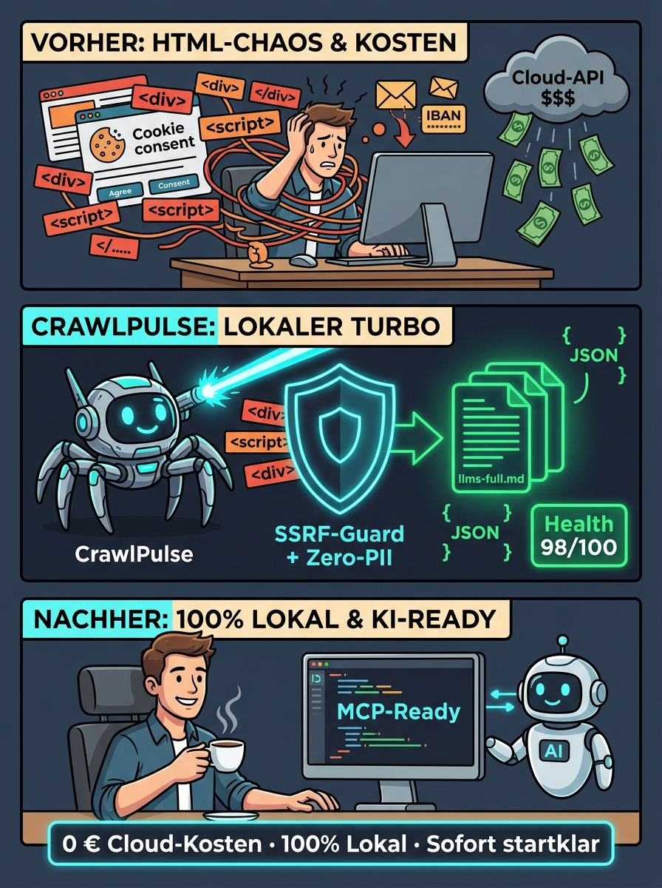

# 🎯 Praxis-Use-Cases: Auswertung, Optimierung & Kostenersparnis

> **Autor:** Aleksey Krivonos · **Lizenz:** [MIT](../LICENSE)
>
> **Herkunft:** Die erklärenden Texte und die Infografik sind KI-erzeugt.

CrawlPulse wurde für Unternehmen, Agenturen und Entwickler konzipiert, die ihren **eigenen Webauftritt** (oder beauftragte Kundenpräsenzen) tiefgehend analysieren, für moderne KI-Suchsysteme rüsten und die **hohen laufenden Kosten kommerzieller SaaS-Dienste eliminieren** wollen – unter strikter Einhaltung von **DSGVO, BFSG und Urheberrecht**.

Herkunft der Abbildung: KI-erzeugt.

---

## 1. Eigene Website für KI-Suchmaschinen (GEO) und das BFSG auditieren

### Das Problem teurer SaaS-Dienste
Kommerzielle SEO- und Barrierefreiheits-Plattformen (wie Screaming Frog Lizenzen, Sitebulb, Ahrefs oder spezialisierte BFSG-Audit-SaaS) verlangen oft dreistellige Jahresgebühren oder monatliche Abonnements. Viele konzentrieren sich zudem rein auf klassisches Google-SEO und ignorieren die neue Generation von KI-Antwortmaschinen (Perplexity, ChatGPT Search, Google AI Overviews).

### Lösung & Mehrwert mit CrawlPulse
CrawlPulse prüft jede erfasste Unterseite automatisch auf zwei kritische Zukunftsfaktoren:
1. **BFSG / WCAG 2.2 Level AA Barrierefreiheit:**
   - Fehlende oder leere Bild-Alternativtexte (`` ohne `alt`-Attribut nach WCAG 1.1.1).
   - Fehlendes oder ungültiges Sprachattribut im HTML-Wurzelelement (`<html lang="...">` nach WCAG 3.1.1).
   - Fehlerhafte Überschriftenhierarchien (fehlende oder mehrfache `<h1>`-Tags).
2. **Generative Engine Optimization (GEO):**
   - Automatische Erkennung und Validierung von Schema.org JSON-LD-Strukturdaten (`Organization`, `Product`, `Offer`, `FAQPage`). Fehlen diese Daten, können KI-Crawler das Angebot nicht verlässlich zitieren.
3. **Konkreter Output:**
   - Ein ganzheitlicher **Health-Score (0–100)**, durchschnittliche Antwortzeiten und priorisierte Fehlerlisten im Tab **„📊 Berichte & Export“**.

### Rechtlicher Rahmen
**100 % zulässig und geschäftskritisch.** Das Auditieren des eigenen Webauftritts bzw. mandatierter Kundeninstanzen dient der Erfüllung gesetzlicher Vorgaben (BFSG ab Mitte 2025) und dem Schutz vor Barrierefreiheits-Abmahnungen.

---

## 2. Drastische Kosten- und Token-Ersparnis gegenüber Cloud-Crawlern & LLM-APIs

### Das Problem teurer SaaS-Dienste
Wer Web-Inhalte über cloudbasierte Scraping-APIs (wie Firecrawl Cloud, Apify oder Zyte) bezieht oder rohes HTML direkt in teure Sprachmodelle (GPT-4o, Claude 3.5 Sonnet) einspeist, verbrennt massiv Budget:
- Bis zu **80–90 % des rohen HTML-Dokuments** bestehen aus repetitiven Mega-Menüs, JavaScript-Bundles, CSS, Tracking-Pixeln, SVGs und Cookie-Bannern.
- Dadurch explodieren die Token-Kosten und das Kontextfenster wird mit inhaltsleerem Rauschen verstopft, was zu Halluzinationen führt.

### Lösung & Mehrwert mit CrawlPulse
- **Lokale Ausführung (0 € SaaS-Abo):** CrawlPulse läuft direkt auf der eigenen Workstation oder dem CI/CD-Server ohne wiederkehrende Monatsgebühren.
- **Intelligente Token-Reduktion:** Die integrierte Readability-Engine entfernt Navigationsbalken, Warenkorb-Dropdowns und Werbe-Container vor der Übergabe an das KI-Modell.
- **Lokale KI-Integration:** Über die native Ollama-Anbindung (`127.0.0.1:11434`, z. B. mit `qwen2.5-coder:7b` oder `llama3.2`) erfolgt die gesamte inhaltliche Analyse bei **0,00 € variablen API-Kosten**.

### Rechtlicher Rahmen
**Vollständig DSGVO- und unternehmenskonform.** Die Datenverarbeitung verbleibt auf lokaler Hardware. Es besteht keine Abhängigkeit von Drittanbietern und kein Risiko von API-Preiserhöhungen.

---

## 3. DSGVO-konforme KI-Auswertung des eigenen Webauftritts (Zero-PII & kein Cloud-Leak)

### Das Problem teurer SaaS-Dienste
Werden Webseiten-Texte mit Kundennamen, Mitarbeiterprofilen, Support-E-Mails oder vertraulichen Impressumsangaben unbedarft an externe US-Cloud-Dienste übertragen, entstehen erhebliche Datenschutzrisiken:
- Pflicht zum Abschluss von Auftragsverarbeitungsverträgen (AVV gem. Art. 28 DSGVO).
- Problematische Drittlandübermittlung (Art. 44 ff. DSGVO) in die USA.
- Gefahr, dass Unternehmensdaten in Modell-Trainingsdatensätze einfließen.

### Lösung & Mehrwert mit CrawlPulse
- **Integrierter Zero-PII-Filter:** Vor jeder Speicherung oder KI-Übergabe werden personenbezogene Identifikatoren (E-Mail-Adressen, Telefonnummern und IBANs) deterministisch durch Platzhalter wie `[E-MAIL-GESCHWÄRZT]` ersetzt.
- **Prompt-Injection-Schutz:** Versteckte DOM-Elemente (`display:none`, `hidden`) und manipulierende Anweisungen im HTML werden eliminiert.
- **Lokale Datensouveränität:** Alle gecrawlten Seiten verbleiben in der lokalen SQLite-Datenbank (`~/.crawl-pulse/crawl-pulse.db`).

### Rechtlicher Rahmen
Entspricht dem Grundsatz **Privacy by Design & by Default (Art. 25 DSGVO)** und minimiert das Risiko von Datenschutzverstößen bei der KI-gestützten Textanalyse.

---

## 4. Automatische Erstellung des eigenen KI-Kontext-Bundles (`llms.txt` & `llms-full.md`)

### Das Problem bisheriger Workflows
Entwickler, KI-Agenten und B2B-Kunden greifen zunehmend über Coding-Assistenten (Antigravity, Cursor, Claude Code) auf Produktdokumentationen und Leistungsübersichten zu. Fehlen maschinenlesbare Standards, müssen Dokumentationsseiten manuell kopiert oder fehleranfällig zusammengefügt werden.

### Lösung & Mehrwert mit CrawlPulse
Mit einem einzigen Klick im Dashboard oder über die CLI erzeugt CrawlPulse standardisierte KI-Dateien:
- **`llms.txt`:** Ein schlankes, semantisches Inhaltsverzeichnis aller Kernseiten nach dem offiziellen `llms.txt`-Standard.
- **`llms-full.md`:** Ein kuratiertes, konsolidiertes Markdown-Gesamtdokument des gesamten Webauftritts, optimiert für den sofortigen Upload in NotebookLM, Claude Projects oder lokale Vektor-Datenbanken.
- **MCP-Schnittstelle:** Ermöglicht es Entwicklungs-Agenten, die eigene Website live per JSON-RPC-Protokoll zu befragen (`ask_crawl`, `get_crawl_bundle`).

### Rechtlicher Rahmen
**Saubere Verwertung der eigenen Inhalte.** Unternehmen behalten die volle Hoheit über ihr geistiges Eigentum und stellen ihre Inhalte strukturiert für autorisierte KI-Systeme bereit.

---

## 5. Relaunch-Monitoring & Regressionsprüfung ohne externe Überwachungstools

### Das Problem teurer SaaS-Dienste
Nach Website-Relaunches, CMS-Migrationen (z. B. von WordPress zu Headless/Shopify) oder größeren Template-Updates gehen häufig unbemerkt Unterseiten verloren (404-Fehler), Canonical-Tags brechen oder wichtige SEO-Texte schrumpfen. Kommerzielle Monitoring-Dienste lassen sich diesen kontinuierlichen Vergleich teuer bezahlen.

### Lösung & Mehrwert mit CrawlPulse
- **SQLite-Historie:** Jeder Crawl-Lauf wird dauerhaft mit Zeitstempel, Statuscodes und Token-Umfang historisiert.
- **Automatischer Diff-Vergleich:** Die integrierte Vergleichs-Engine (`compareRuns`) stellt zwei Zeitpunkte tabellarisch gegenüber:
  - Neu hinzugekommene oder weggefallene Unterseiten.
  - Geänderte Seitentitel und signifikante Token-Abweichungen (Content-Verlust).
  - Delta des technischen Health-Scores.
- **SSRF-Schutz für Staging-Systeme:** Der strikte SSRF-Guard verhindert, dass versehentlich sensible interne Entwicklungsumgebungen unkontrolliert gescannt werden.

### Rechtlicher Rahmen
Ordnungsgemäße IT-Administration und Qualitätssicherung auf den eigenen Systemen. Verhindert geschäftsschädigende Ranking- und Umsatzverluste nach Code-Deployments.
